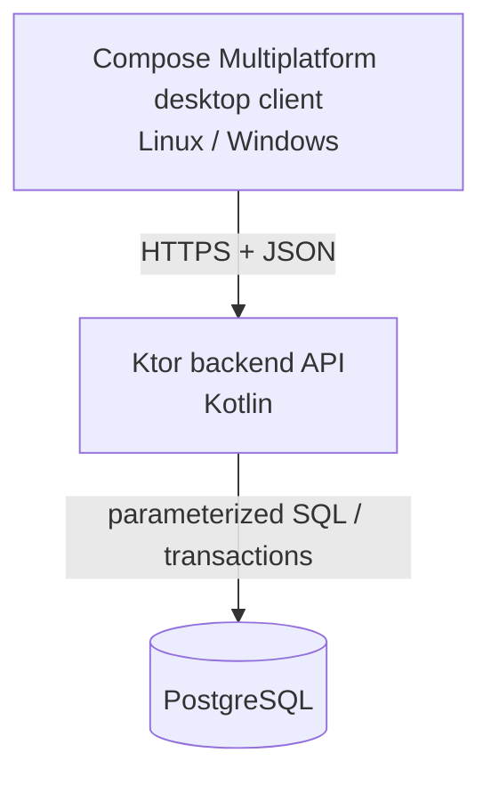

# Proposed Architecture — v0.1

## Responsibilities
**Desktop client:** Screens, navigation, form state, client-side validation, and authenticated calls to the API. It must not store raw PostgreSQL credentials.

**Backend:** Sign-in/session handling, validation, authorization, ticket workflows, transaction boundaries, and API response shaping.

**PostgreSQL:** Persistent state, foreign keys, unique constraints, indexes, and transactional consistency.

## Proposed modules
- `client/`: desktop GUI, screen state, API client.
- `server/`: HTTP routes, services, authorization, persistence adapters.
- `database/migrations/`: ordered SQL migrations.
- `docs/`: project decision and demonstration material.

## Decisions to revisit
- Authentication/session strategy and established password-hashing library.
- HTTP client and persistence library (favor demonstrating readable SQL even if a library is used).
- Migration runner (Flyway or a similarly appropriate tool).
- Deployment layout for the demonstration.

## Scope-control rule
No feature is added only because a mature help desk product would have it. Add features when they demonstrate a course objective, are needed for a usable MVP, or follow a documented requirement change.
