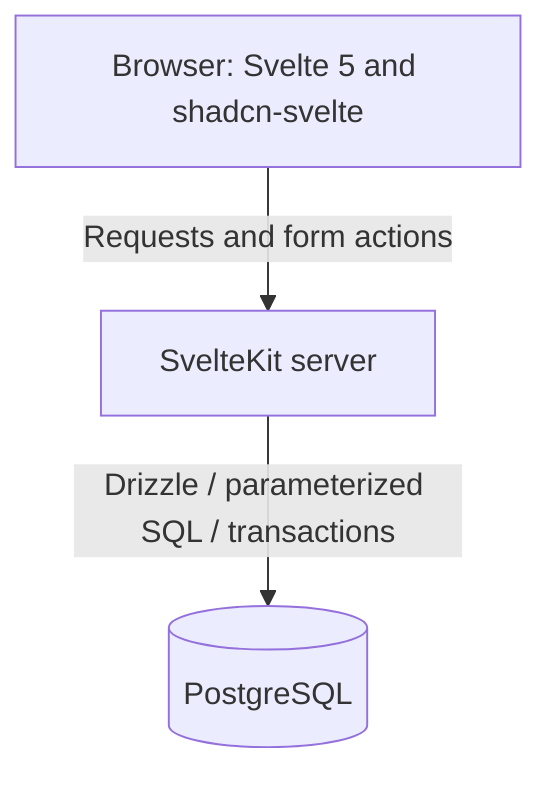

# Proposed Architecture — Web Baseline v0.4

## Responsibilities
**Browser:** responsive ticket list/details UI, navigation, forms, loading and error feedback. It never receives database credentials.

**SvelteKit server:** authentication, secure sessions, authorization for each operation, validation, ticket workflows and database transactions. No separate API backend is planned.

**PostgreSQL:** persisted tickets, identities, references, constraints, indexes, and transactional consistency.

## Proposed source structure
- `src/routes/`: login, authenticated ticket workspace and limited administration.
- `src/lib/components/`: shadcn-svelte components and minimal ticket-specific components.
- `src/lib/server/db/`: Drizzle schema and database connection.
- `src/lib/server/auth/`: sessions and permissions.
- `src/lib/server/services/`: transactional business workflows.
- `src/lib/schemas/`: validation schemas.
- `drizzle/`: versioned SQL migrations generated and reviewed with Drizzle Kit.
- `docs/`: technical and stakeholder-facing documentation.

## Key decisions
Professor Enke recommended a web app. SvelteKit's integrated server eliminates extra client/API plumbing for a short-lived class project, while keeping PostgreSQL as the learning focus. Drizzle is intended to reduce boilerplate, not to avoid writing, reviewing and explaining SQL.

## Security and testing
Use established password hashing, secure HTTP-only session cookies, and server authorization for reads and writes. Avoid committing credentials. Use tests against a real PostgreSQL instance for constraints and transactions, and demonstrate database backup and restore.

## Open decisions
Specific access rules, session implementation, database indexes, deployment details and final database schema need review before implementation. This is a design proposal, not a description of existing code.
