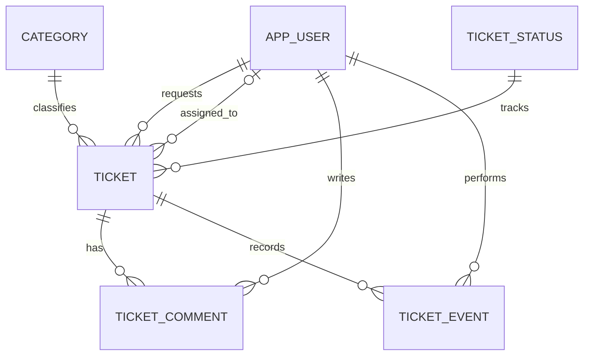

# Database Design — Initial Draft v0.1

## Entity relationships

## Initial tables
- `app_user`: identity, login email, password hash, role, enabled flag.
- `category`: approved ticket categories.
- `ticket_status`: controlled list of ticket statuses.
- `ticket`: title, description, requester, optional assignee, category, status, timestamps.
- `ticket_comment`: message associated with a ticket and its author.
- `ticket_event`: server-recorded change type and structured details for future history/audit display.

## Design notes
- Foreign keys prevent orphaned records.
- A ticket must have a requester, category, and status; assignment is optional.
- The single `assigned_to_user_id` column intentionally supports only one agent per ticket in v0.1.
- Roles are represented with a constrained text value in the first version for simplicity. A permissions or role-membership table can be introduced later if needed.
- `ticket_event.details` uses `jsonb` to record event-specific metadata without turning core ticket attributes into unstructured documents.
- The server is responsible for creating the audit events in the same database transaction as a state change. A future requirement may justify triggers or a different audit approach.

## Planned example queries
1. Ticket list by requester, joined to category and status.
2. Open tickets assigned to a specific agent.
3. Number of tickets per status and category (demonstrating aggregation).
4. Ticket details with paginated comments and event history.
5. Transactional status update plus audit event insertion.

## Safety and recovery
Use development-only fictional sample data. Document database users and permissions separately from application users, use parameterized queries, keep credentials outside source control, and test a `pg_dump` / restore procedure before the final demonstration.

## Migration
See `database/migrations/V001__initial_schema.sql`. It is an **unexecuted design proposal** until PostgreSQL is available and tests confirm that the application logic works against it.
